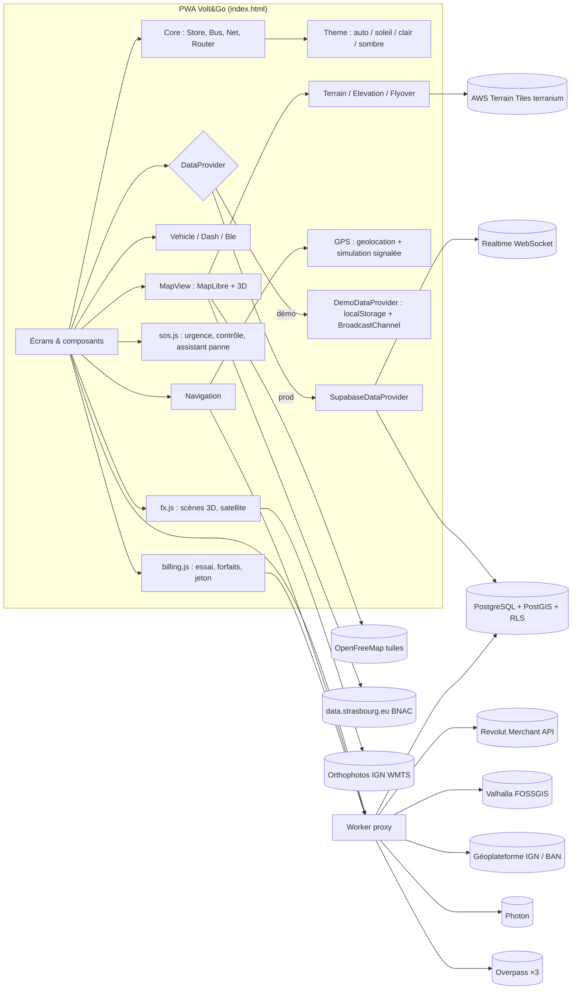

# Architecture

## Vue d'ensemble



Sans Worker configuré, l'app appelle directement les API (toutes autorisent le CORS).

## Choix techniques

| Sujet | Choix | Pourquoi |
|---|---|---|
| Front | HTML/CSS/JS vanilla, fichier unique | Aucun build obligatoire, déploiement GitHub mobile, migrable (modules séparés en développement) |
| Carte | MapLibre GL 5.6.0 (WebGL) + OpenFreeMap | Gratuit, sans clé, vectoriel, bâtiments 3D natifs |
| 3D « utile » | `fill-extrusion` des bâtiments en navigation et à la demande | Repérage aux carrefours ; Three.js réservé à la scène de présentation (chargé à la demande) |
| Itinéraires | Valhalla `bicycle` avec options par profil | Réglages par requête (`use_roads`, `avoid_bad_surfaces`…) impossibles avec l'OSRM public |
| Recherche | BAN (adresses) + Photon (lieux) + fiches locales | Nominatim interdit l'autocomplétion |
| Backend | Supabase (Postgres + PostGIS, Auth, Realtime, RPC) | Couvre REST + WebSocket + auth sécurisée à 0 € |
| Proxy | Cloudflare Worker | Cache, quotas, `X-Client-Id`, bascule Overpass |

## Modules (sources de `index.html`)

Le fichier unique est assemblé depuis des modules (archive de développement fournie à part) :

| Module | Contenu |
|---|---|
| `logic.js` | Fonctions pures testées : géométrie, décodage polyline, confiance/expiration, anti-spam, autonomie, horaires OSM, soleil, validation |
| `core.js` | `CONFIG`, utilitaires DOM, `Store` sûr, `Bus`, `Net` (timeout, annulation, nouvelle tentative, santé), toasts, modales, routeur, préférences |
| `data.js` | Fiches vérifiées, `OSM` (Overpass + cache + instantané), `DemoDataProvider`, `SupabaseDataProvider`, `Auth`, `UserData` |
| `osm-snapshot.js` | Instantané OSM daté (ateliers, recharges, gonflage, **fontaines** depuis la v0.9) utilisé si toutes les instances Overpass échouent |
| `geo.js` | `GPS` (états, erreurs, précision, perte de signal, simulation signalée), batterie du téléphone, Wake Lock |
| `map.js` | `MapView` : styles jour/nuit, calques, BNAC par cellules, itinéraires, marqueurs, suivi, 3D ; `firstSymbolLayer()` (v0.9) insère les couches au-dessus de la voirie et des bâtiments mais sous les libellés ; `tuneNight()` (v0.10) et `tuneDay()` (v1.0) retouchent les styles ; `resolveTheme()` : Auto = soleil, `app` suit l'apparence |
| `features.js` | Panneau inférieur, sélection sur carte, recherche, `ROUTE_STYLES` (Rapide / Sûr / Confort, v1.0) + `Routing`, `RoutePreview` (2 calculs + Confort au toucher), `Nav` (HUD, alertes, ETA), `Reports` (18 types, pastilles rondes), énergie & secours |
| `hud.js` | **v1.0** : `Menu` (menu latéral ☰, 14 entrées, glissement), pages `community` et `battery`, `Speedo` (compteur de vitesse GPS lissé, anneau, > 25 km/h), `VEHICLE_KINDS` + `Onboard` (bienvenue → véhicule → domicile / travail, `Store onboarded`) |
| `layers.js` | **v0.9** : `LAYER_DEFS` (12 calques, groupes, sources), `CityData` (open data Eurométropole : tram, arceaux compactés, Vélhop, trafic SIRAC, travaux, alertes ; arrêts de bus Overpass par cellule de vue ; Open-Meteo météo + air ; cache mémoire / `localStorage` avec TTL), `Weather` (puce vivante dans la rangée de filtres, fiche 6 h, conseils trottinette), `Overlays` (sources GeoJSON et couches MapLibre : clusters, lignes de trafic colorées, polygones de travaux ; visibilité selon `Prefs.layers`, chargement paresseux, minuteries temps réel suspendues hors carte, fiches au clic) |
| `vehicle.js` | Catalogue des marques (app officielle, Apple Localiser), `Vehicle` (fiche : V, Ah, autonomies, km voulus, chargeur…), `WIDGETS` + `Dash` (tableau de bord, mini-carte, scène 3D, calculateur `Logic.rangePlan`), `Sub` (sous-pages), `Customize`, `VehicleForm`, `Recorder`, `History`, **`Carnet`** (v0.4 : carnet d'entretien, rappels remis à zéro), **`ScooterPhoto`** (v0.6 : photo libre du modèle via Wikimedia Commons ou photo du client), bons réflexes, rapport de diagnostic. **Plus aucun code de connexion Bluetooth** (retiré en v0.4). |
| `terrain.js` | **v0.2** : `Advanced` (mode avancé type OsmAnd, profil EDPM), `Terrain` (relief `raster-dem` + ombrage), `Elevation` (tracé coloré selon la pente, graphique SVG interactif), `Flyover` (survol 4D animé), export GPX, lien OsmAnd |
| `fx.js` | `Three` (chargement unique), `ScooterModel` (modèle procédural + carte d'environnement PMREM), `mountScene`, `HeroScene` (sol et brouillard suivent le thème), `DashScene`, `SosScene`, `MapScooter` (couche personnalisée MapLibre, marqueur 3D orienté, ≈ 14 px en navigation), `Satellite` (orthophotos IGN). **`Nebula`** (v0.7 : fond WebGL nébuleuse) et **`CityScene`** (v0.7 : Strasbourg en 3D sur l'accueil). |
| `sos.js` | **v0.3** : `Sos` (fenêtre Urgence, signalement de contrôle), `Panne` (assistant 3 questions → `Logic.matchShops`), `SOSButton` |
| `billing.js` | **v0.3** : `Billing` (essai, état, garde-fou `gate()`, jeton, Revolut via Worker ou paiement DÉMO, changement, désinscription, pages Forfaits / Paiement, carte Réglages, forfaits de la landing) |
| `uifx.js` | **v0.6** : `UIFX` (projecteur à écouteur unique, compteurs animés, apparition au défilement, retour haptique, anneau de vitesse) |
| `screens.js` | Onglets (Dashboard, Carte, Signaler, Réparer, Réglages), trajets, réparer, page Réglages, `Layers` (rangée de filtres dynamique + panneau « Calques et carte » par groupes, v0.9), mentions, panneau DEV, scène 3D, auth, GPS, démarrage (`App.enter` / `App.boot` / `App.ensureMap`) |

## Parcours

```
Landing → Inscription/Connexion → Explication GPS → Dashboard (accueil, mini-carte en haut)
  Dashboard → Ma trottinette (fiche V/Ah) · Autonomie & calcul · Carnet d'entretien · Personnaliser · Historique · Bons réflexes
  Dashboard → Carte → Recherche → Aperçu d'itinéraire (profils + EDPM, dénivelé, % batterie, GPX, OsmAnd, survol 4D)
            → Navigation (alertes montées, tracé enregistré si activé) → Arrivée → Historique
  + Signaler → Fiche signalement (vote, abus)
  Réparer (liste ⇄ carte) → Fiche établissement
  Secours (recharge → atelier → Strass&Go)
  Réglages → profil, trottinette, tableau de bord, navigation (mode avancé), notifications, confidentialité, sécurité
```

Un utilisateur déjà connecté (ou invité) arrive directement sur le Dashboard, **si son essai ou son abonnement est valide** : sinon `Billing.gate()` ouvre l'écran Forfaits bloquant (`body.paywall-on`, barre du bas masquée), et `Tabs.go` refuse toute navigation tant que ce n'est pas réglé.

Ordre d'assemblage des modules (`build.py`) : `osm-snapshot`, `core`, `data`, `geo`, `map`, `features`, `vehicle`, `terrain`, `fx`, `sos`, `billing`, `screens`. Le lien `#app` ouvre directement la carte. La carte principale n'est créée qu'au premier affichage (`App.ensureMap`), ce qui accélère l'accueil.

## Écrans et barre du bas (v0.2)

| Écran | Élément | Contenu |
|---|---|---|
| Dashboard | `#screen-dash` › `#dash-inner` | Mini-carte MapLibre non interactive + cartes `WIDGETS` dans l'ordre choisi |
| Carte | `#screen-app` | Carte plein écran, panneau inférieur, recherche, navigation |
| Réglages | `#screen-settings` › `#settings-inner` | Cartes de réglages (remplace l'ancien onglet Profil) |
| Sous-page | `#screen-sub` › `#sub-inner` | `Sub.open('customize' \| 'vehicle' \| 'history' \| 'tips' \| 'edpm' \| 'panne' \| 'plans' \| 'pay')` avec bouton retour rond ; les modules enregistrent leurs pages dans `Sub.pages` |

La barre `.tabbar` est au niveau de `<body>`. Elle est visible sur Dashboard, Carte et Réglages, et masquée pendant la navigation (`body.nav-on`). `Router.go` écrit `body[data-screen]`, et la CSS s'appuie dessus.

## Rendu 3D et performance (v0.3)

- Thème (`Theme`, core.js) : `data-theme` sur `<html>`, jetons CSS (`--ink-*`, `--text-*`, `--line`, `--card-bg`, `--bar-bg`, `--well`, `--c-ok/warn/danger/info/demo/accent`) ; mode auto via `prefers-color-scheme`, mode soleil via `Logic.isNight`, `meta theme-color` mis à jour, évènement `theme` pour les scènes 3D.
- Three.js (≈ 670 Ko, mis en cache par le service worker) est chargé une seule fois, en différé. Chaque scène est montée par `mountScene`, qui gère le renderer, `IntersectionObserver`, `ResizeObserver`, la limite d'images par seconde et « réduire les animations ».
- Le modèle de trottinette est construit en géométries de base (pas de fichier GLB) et partage une carte d'environnement PMREM générée à partir de panneaux lumineux.
- Sur la carte, le marqueur 3D est une couche personnalisée MapLibre (`renderingMode: '3d'`) qui partage le contexte WebGL de la carte ; la matrice vient de `args.defaultProjectionData.mainMatrix` (MapLibre 5).

## Synchronisation fiche véhicule → carte

`Vehicle.set()` fusionne les champs et émet un évènement. Le Dashboard se redessine, l'autonomie est recalculée, et l'itinéraire suivant utilise :

- `Vehicle.cruiseKmh()`, plafonné à 25 km/h, comme vitesse du profil Trottinette ;
- `batteryWh()`, `baseWhPerKm()` et le mode (éco, standard, sport) pour le « % utilisés » ;
- le kilométrage pour les échéances d'entretien.

Plus tard, Supabase synchronisera la même fiche entre appareils (table `vehicles`, voir `supabase-schema.sql`).

## Modèles de données

Correspondance avec le cahier des charges ; les tables complètes sont dans `supabase-schema.sql`.

| Modèle demandé | Table | Champs clés |
|---|---|---|
| User | `auth.users` + `profiles` | id, first_name, email (Auth), mot de passe haché (Auth), vehicle (jsonb : type, modèle, autonomies), preferences, role, trust, created_at |
| Report | `reports` (+ `report_votes`, `report_flags`) | id, type, geom (PostGIS), created_by, created_at, expires_at, confirms, denies, flags, status |
| Business | `businesses` | id, name, category, geom, address, phone, website, opening_hours, **source**, source_url, verified_at, trust |
| Route | non stocké côté serveur | calculé à la demande |
| Trip (historique) | appareil uniquement en v0.2 | opt-in, désactivé par défaut : destination, distance, durée, vitesse max, **tracé simplifié (≤ 400 points)**, 60 trajets max ; export GPX, suppression |
| Blackout (ordre préfectoral) | `blackouts` | point, rayon, début, fin, référence ; lecture publique, écriture admin |
| Subscription / Payment | `subscriptions`, `payments` (écrites par le Worker) | forfait, statut, dates, référence de commande, montant ; lecture par le propriétaire |
| Vehicle | appareil → `vehicles` (prévu) | marque, modèle, tension, capacité, autonomies, km voulus, chargeur, vitesse, moteur, mode, poids, compteur, assurance ; **aucun numéro de série exigé** |
| MaintLog (carnet) | appareil (`maintLog`, 200 lignes max) | type, date, compteur, atelier, coût, note |

États d'un signalement : `active` (Nouveau < 15 min) → `confirmed` (≥ 2 « toujours présent ») / `disputed` (≥ 2 « plus présent ») → `expired` ; `review` après 3 alertes d'abus ; `removed` par l'auteur ou la modération.

Durées de vie : obstacle 2 h, piste bloquée 4 h, route bloquée 6 h, autre 3 h, déviation / recharge / vigilance 24 h, travaux 72 h, chaussée 7 j. « Toujours présent » prolonge de 50 % (plafond 2× la durée) ; « plus présent » raccourcit.

## Extension multi-villes

`CONFIG.cities` décrit chaque ville : centre, emprise, jeu d'aménagements cyclables, service de transport. Pour ajouter Mulhouse ou Metz : une entrée dans `CONFIG.cities`, une ligne dans la table `cities`, et un fournisseur d'aménagements (sinon, repli automatique sur les pistes OSM des tuiles).

## Sécurité

- Mots de passe : Supabase Auth (bcrypt) en production ; PBKDF2-SHA256 150 000 itérations en démo, avec limitation des tentatives.
- Écritures sur les signalements **uniquement** via RPC `security definer` (anti-spam, doublons, votes uniques) ; RLS sur toutes les tables.
- Entrées assainies côté client (`sanitizeText`) et côté SQL (`regexp_replace`, contraintes de longueur).
- Aucun HTML utilisateur injecté sans échappement (`esc()` partout).
- Clé `service_role` jamais côté client ; CORS du Worker limité aux domaines déclarés.
