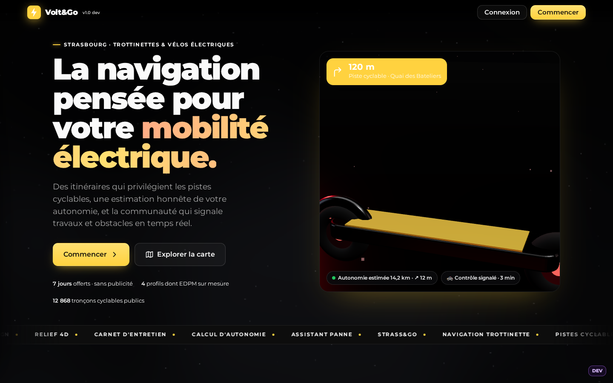
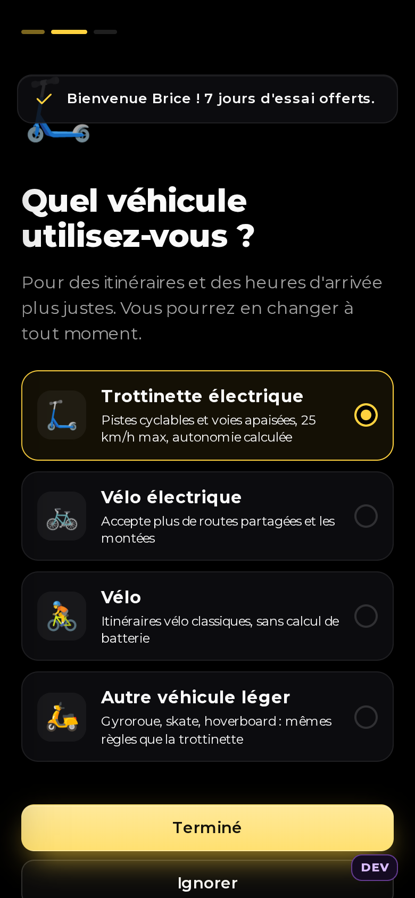
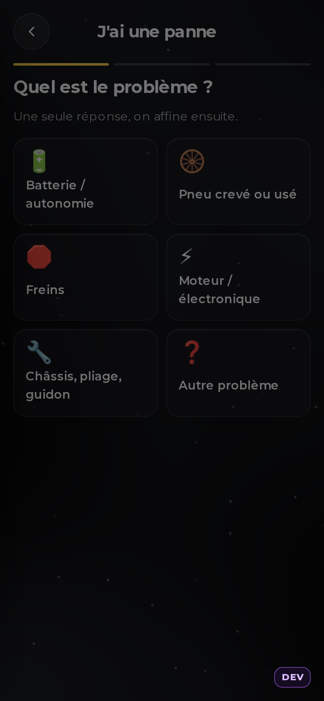
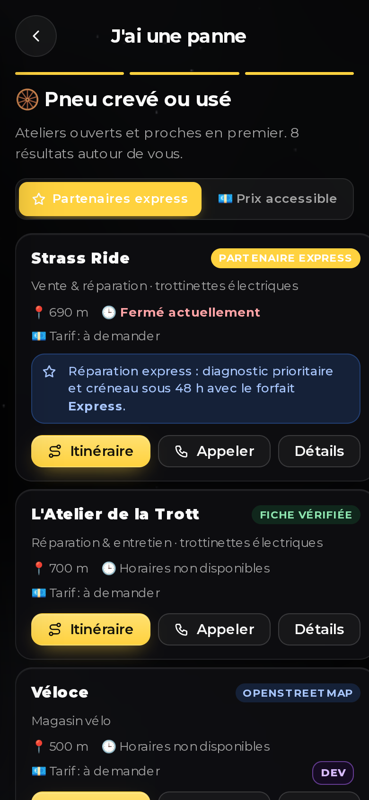
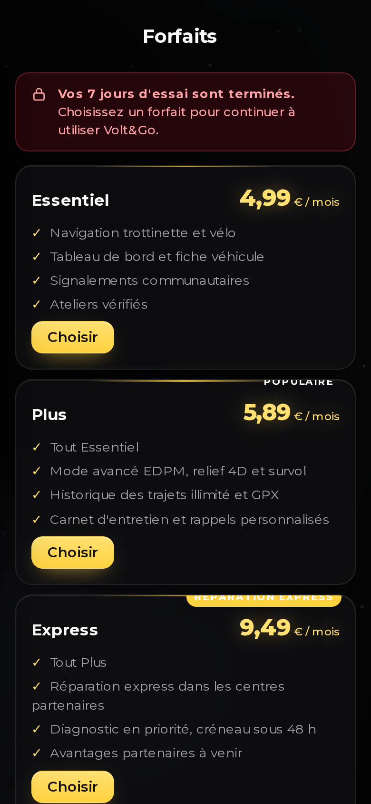
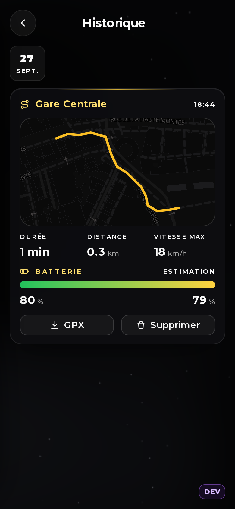
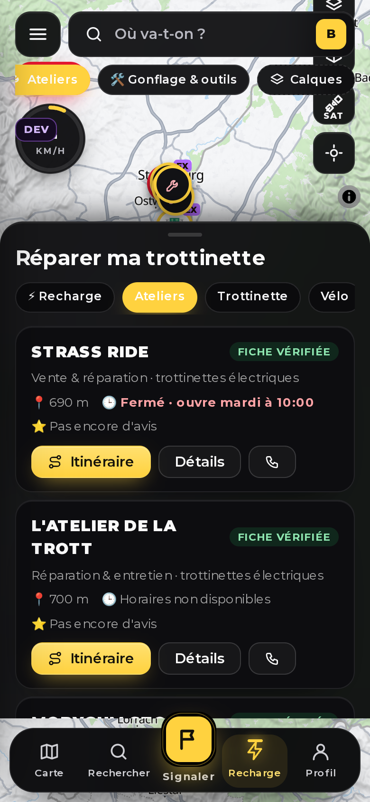

# Volt&Go — la navigation pensée pour votre mobilité électrique

Volt&Go est une application web progressive (PWA) de navigation pour **trottinettes et vélos électriques**. Elle est conçue d'abord pour **Strasbourg et l'Eurométropole**, avec une architecture prête pour le Grand Est, puis la France et l'Europe.

> **Statut : prototype v1.0.0-dev (version développeur).**
> - La carte, le GPS, la recherche, les itinéraires avec dénivelé, la navigation guidée, la vue satellite et les ateliers utilisent de **vraies données** et de **vrais services**.
> - Les comptes, les signalements et les abonnements tournent en **mode démo local**, dans le navigateur, tant que Supabase et le Worker ne sont pas branchés. Le paiement Revolut est simulé sans Worker.
> - **Aucune connexion à la trottinette** : les constructeurs n'ouvrent pas d'API, donc rien de fiable. Toutes les données de la trottinette sont saisies par le client (tension, ampérage-heure, autonomie, niveau), et l'app calcule.
> - Tout ce qui est simulé ou démo est signalé en violet dans l'interface.
> - **Thème** : noir profond par défaut, **mode clair intelligent** (suit le téléphone, ou le soleil, ou votre choix) avec un texte toujours lisible : noir sur clair, blanc sur sombre.



## Aperçu

| Accueil (tableau de bord) | Ma trottinette | Carnet d'entretien | Carte (panneau façon Uber) |
|---|---|---|---|
|  |  |  |  |

| Choisir un trajet | Navigation (trottinette 3D) | Survol 4D | Mode avancé EDPM |
|---|---|---|---|
|  |  |  |  |

| Onboarding : véhicule | Carte (premier écran) | Menu ☰ | Navigation |
|---|---|---|---|
|  |  |  |  |

| Calques et carte | Trafic temps réel + tram | Météo & air | Satellite |
|---|---|---|---|
|  |  |  |  |

| Urgence | Contrôle de police | Assistant panne | Résultats panne |
|---|---|---|---|
|  |  |  |  |

| Inscription page par page | Forfaits (fin d'essai) | Paiement Revolut | Réglages / abonnement |
|---|---|---|---|
|  |  |  |  |

| Vue satellite IGN | Historique des trajets | Signaler | Réparer |
|---|---|---|---|
|  |  |  |  |

| Mode clair : Dashboard | Mode clair : carte | Mode clair : réglages | Bureau : accueil clair |
|---|---|---|---|
|  |  |  |  |

Version bureau :


## Ce que fait l'application

| Fonction | Détail | Données |
|---|---|---|
| **Panneau sous la carte façon Uber** | Panneau plus haut (44 % de l'écran au repos, 62 % ouvert) : tuiles Domicile / Travail, tuiles Réparer / Recharger / Bus / Trajets, autonomie, récents, signalements autour de vous. Les trajets se choisissent en lignes (icône, profil, durée, arrivée, % de batterie à droite) avec un grand bouton « Choisir · Démarrer » | Local |
| **Expérience GPS communautaire (v1.0)** | Onboarding (bienvenue → type de véhicule → domicile / travail → position), **carte en premier écran**, barre du bas Carte · Rechercher · **Signaler** · Recharge · Profil, **menu ☰ latéral** (14 entrées), **compteur de vitesse GPS en direct** (rouge au-delà de 25 km/h), SOS compact, panneau de manœuvre + bandeau d'alertes + barre ETA façon GPS, **18 types de signalement** avec pastilles rondes (police en bleu 👮), itinéraires **Rapide / Sûr / Confort** expliqués, fiche lieu avec 4 actions et « Voir les itinéraires ». Palette **jaune (action) / rouge (alerte) / noir / blanc**. Carte « type GPS » claire le jour, sombre la nuit | Local + Valhalla + OSM |
| **Noir profond pro (v0.10)** | Apparence sombre par défaut quel que soit le téléphone, carte en style nuit retouché (fond `#0a0a0c`, voirie lisible), surfaces en noir profond translucide (plus de verre blanchâtre), barre du bas et puces quasi opaques donc lisibles sur la carte, marqueurs noirs à bord coloré, ateliers masqués de loin. Le mode clair reste un choix dans Réglages | Local |
| **Design « noir profond & rouge »** | Fond noir pur, accent rouge, conteneurs fins, **barre du bas flottante** en verre avec indicateur rouge et bouton + en relief, animations d'entrée en cascade | Local |
| **WebGL partout** | Fond **noir profond animé et neutre** (shader plein écran : nappes de graphite qui dérivent, poussière fine qui scintille, réaction au pointeur et au défilement ; blanc et gris pâle en clair), scène **Strasbourg en 3D** sur l'accueil (Grande Île, Ill, cathédrale, immeubles qui sortent du sol, trajet qui se dessine, parallaxe au pointeur), hero avec traînées de vitesse et poussière, trottinette du Dashboard **à faire tourner au doigt** avec inertie, cartes de l'accueil inclinées en 3D au survol | WebGL brut + Three.js r160 |
| **Conteneurs « verre iOS »** | Toutes les cartes, tuiles, boutons ronds, barre du bas, panneau, modales : verre translucide (flou 22–28 px, saturation), bord fin, reflet supérieur, **accent rouge** en liseré haut, icônes et titres de section rouges | Local |
| **Effets d'interface** | Écran d'accès en verre sur halos « aurora », étapes numérotées, champs à icône ; projecteur qui suit la souris sur les cartes ; faisceau lumineux qui tourne autour de la carte « Ma trottinette » ; chiffres qui montent ; anneau de vitesse ; marquee et apparition au défilement sur l'accueil ; retour haptique sur la barre. Tout se coupe avec « réduire les animations ». | Local (CSS + JS, aucune dépendance) |
| **Mode clair (optionnel)** | Réglages → Apparence : Sombre (défaut), Auto (suit le téléphone), Soleil (clair le jour), Clair. Tous les jetons de couleur basculent, y compris les textes sur badges et notices (contraste vérifié à 17,9:1) | Local |
| **Trottinette 3D** | Trottinette en mouvement sur l'accueil, tournante sur le Dashboard, **marqueur 3D sur la carte à votre position** (comme la voiture de l'app Tesla), bouton d'urgence animé | Three.js r160, modèle procédural |
| **Calques de données = filtres** | Puce « Calques » à droite des 5 filtres de base : **12 calques** classés par groupe (Fond de carte, Aménagements, Communauté, Services, Transports, Trafic & travaux, Météo), chacun avec sa source. Nouveaux en v0.9 : **arceaux vélo** (5 700, en clusters), **fontaines à eau**, **stations Vélhop** (vélos et places en temps réel : plan B en cas de panne), **tram & bus** (stations de tram, arrêts de bus dès le zoom 15), **trafic temps réel** (fluide / dense / saturé sur les grands axes, toutes les 3 min), **travaux & alertes** (chantiers voirie de l'année, alertes de circulation), **météo & qualité de l'air** (puce vivante dans la rangée de filtres : température, vent, pluie annoncée, indice de l'air, conseils trottinette). Rien n'est téléchargé avant l'activation ; les couches denses sont regroupées et n'apparaissent qu'à un zoom lisible ; les flux temps réel s'arrêtent dès qu'on quitte la carte. Un clic sur n'importe quel point ouvre une fiche (source, horaires, itinéraire) | Eurométropole de Strasbourg (Licence Ouverte), OpenStreetMap (ODbL), Open-Meteo (CC BY 4.0) |
| **Vue satellite** | Bouton SAT à droite de la carte : orthophotos IGN, routes et libellés conservés | Géoplateforme IGN (Licence Ouverte) |
| **Urgence** | Bouton animé en bas à gauche : signaler un **contrôle de police** (visible par tous, à l'endroit précis), **J'ai une panne !**, secours batterie, appels **17 / 18 / 112** | Communauté + fiches ateliers |
| **Assistant panne** | Une question par écran (type de panne, trottinette à vous ou en libre-service, pressé ou non), puis les ateliers adaptés ; bascule « partenaires express » / « prix accessible » sans jamais inventer un prix | Fiches vérifiées + OSM |
| **Inscription page par page** | 3 écrans, 2 questions maximum par écran, essai de 7 jours sans carte | Local → Supabase Auth |
| **Forfaits** | Essentiel 4,99 €, Plus 5,89 €, Express 9,49 € par mois ; blocage à la fin de l'essai et à chaque échéance (29 jours) ; changement de forfait à tout moment ; désinscription en 3 clics | Revolut Merchant via le Worker |
| **Accueil (tableau de bord)** | Petite carte en haut, puis des cartes : ma trottinette (3D), autonomie & calcul, compteur, actions rapides, batterie, carnet d'entretien, distance, historique, bons réflexes. On peut les réordonner et les masquer avec « Personnaliser ». | Fiche véhicule saisie par le client |
| **Ma trottinette** | Fiche complète : marque, modèle, **tension (V) et capacité (Ah)** → énergie (Wh), autonomies annoncée et constatée, **distance que je veux pouvoir parcourir**, chargeur, vitesse bridée, moteur, mode, poids, compteur, assurance. Cette fiche alimente automatiquement l'autonomie, le calcul des itinéraires et la navigation. | Saisie utilisateur, stockée sur l'appareil |
| **Photo de la trottinette** | Dès que marque et modèle sont renseignés, l'app cherche une **photo libre du modèle** sur Wikimedia Commons (licence et auteur affichés) ; le client peut aussi prendre **sa propre photo** (caméra ou galerie, compressée, stockée sur le téléphone). Aucune photo constructeur copiée. | Wikimedia Commons + appareil |
| **Calculateur d'autonomie** | Bornes en km du client : km possibles maintenant, km sur batterie pleine, consommation Wh/km, et « est-ce que je peux faire X km ? » à partir de la tension (V), de la capacité (Ah), de l'autonomie constatée et du niveau. Réserve de 10 % conservée. | Saisie client |
| **Carnet d'entretien** | Interventions notées (type, date, compteur, atelier, coût, note), rappels remis à zéro automatiquement, export texte | Appareil |
| Carte | Vectorielle, claire le jour et sombre la nuit (calcul du coucher du soleil à Strasbourg), bâtiments en 3D, **relief 3D et ombrage** en mode avancé | OpenFreeMap / OSM + modèle numérique de terrain AWS Terrain Tiles |
| Pistes cyclables | 5 niveaux : piste, voie verte, bande, mixte, double sens non matérialisé | Open data Eurométropole (jeu BNAC) + OSM |
| GPS réel | L'autorisation est expliquée avant la demande. Les cas refus, indisponible, délai, précision faible et signal perdu sont gérés. | `navigator.geolocation` |
| Recherche | Adresses, lieux, gares et ateliers, avec favoris, domicile, travail et récents | BAN (IGN) + Photon + fiches locales |
| Itinéraires | 3 profils plus un **profil EDPM sur mesure**, jusqu'à 3 alternatives, **dénivelé D+ / D−**, tracé coloré selon la pente et **% de batterie utilisé** (montées comprises) | Valhalla (FOSSGIS) |
| **Mode avancé (type OsmAnd)** | Vitesse de croisière (≤ 25 km/h), évitement des routes principales, des pentes et des revêtements dégradés, trajet le plus court, relief 3D, **survol 4D** du trajet, export **GPX** et ouverture dans **OsmAnd** | Valhalla + terrain AWS |
| Navigation | Guidage virage par virage, voix en français, **alerte avant les montées**, recalcul hors trajet, écran maintenu allumé, enregistrement du tracé si activé | Local + Valhalla |
| **Historique des trajets** | Onglets par jour, carte du tracé, statistiques, export GPX, suppression. Désactivé par défaut. | Appareil uniquement |
| **Entretien** | Échéances pour la pression des pneus, les freins, le serrage et la révision, selon les kilomètres et la date | Fiche véhicule |
| Secours | Recharge à portée → atelier → **Besoin d'un bus ? (Strass&Go)** | OSM + Strass&Go |
| Signalements | 9 types, confirmation ou contestation, indice de confiance, expiration, anti-spam, modération | Démo locale → Supabase |
| Réparer | Liste et carte synchronisées ; fiches avec source et horaires ; ouvert/fermé affiché seulement quand il est fiable | 6 fiches vérifiées + OSM |

Trois choses sont **absentes volontairement** (détail dans [LEGAL-RGPD.md](LEGAL-RGPD.md)) :

- aucun signalement de radar (article R413-15 V du Code de la route) ;
- aucun débridage (article R311-1) ;
- aucune commande à distance de la trottinette (aucune API constructeur publique).

Et deux choses sont **encadrées** :

- les **contrôles de police** peuvent être signalés (comme sur Waze), mais l'app applique automatiquement le **masquage préfectoral** prévu par les articles L130-11 et L130-12 (module `blackouts`) ;
- les **frais de désinscription** (un mois) sont configurables (`CONFIG.billing.cancelFeeMonths`) et signalés comme une clause à faire valider par un juriste.

## Pourquoi il n'y a pas de connexion à la trottinette

Aucun constructeur (Xiaomi, Segway-Ninebot, Dualtron/Minimotors, Kaabo, Vsett, Niu, Apollo, Pure, Okai…) ne publie d'API ou de SDK pour les applications tierces. Les seuls protocoles connus sont des rétro-ingénieries communautaires qui ne marchent que sur de vieux firmwares non chiffrés, et sonner ou bloquer à distance demande un module 4G et un accord constructeur. Plutôt que d'afficher une fonction qui ne marcherait pas chez la plupart des clients, la v0.4 la **retire** : la fiche demande les vraies caractéristiques (V, Ah, autonomie constatée, compteur), le calculateur fait le reste, et le carnet d'entretien remplace les « données remontées ».

## Démarrage rapide

**En ligne (GitHub Pages)** : déposez les fichiers de ce dépôt à la racine du dépôt, puis activez Pages (branche `main`, dossier `/root`). Le guide pas à pas est dans [DEPLOIEMENT.md](DEPLOIEMENT.md).

**En local** (la géolocalisation exige `https` ou `localhost`) :

```bash
python3 -m http.server 8765
# puis ouvrir http://localhost:8765
```

Le bouton **DEV** (violet) ouvre le panneau développeur : état des API, GPS, simulation de position, ordre préfectoral simulé, fin d'essai forcée, modération, journal.

**Comptes de test** : l'inscription est locale (mode démo). Créez n'importe quel compte, il démarre avec 7 jours d'essai. Pour tester le blocage et le paiement sans attendre : DEV → « Terminer mon essai », puis « Simuler le paiement (DÉMO) ».

## Navigation dans l'app

La barre du bas flottante (68 px, en verre, 10 px du bord) comporte 5 onglets : **Dashboard** (accueil), **Carte**, **+ Signaler** (bouton central rouge surélevé), **Réparer** et **Réglages**. Sur ordinateur, elle devient une barre latérale de 96 px. Elle disparaît pendant la navigation guidée.

## Fichiers du dépôt (tout à la racine, sans dossier)

| Fichier | Rôle |
|---|---|
| `index.html` | L'application complète (fichier unique, ~710 Ko) |
| `sw.js`, `manifest.webmanifest`, `icon.svg` | PWA installable |
| `supabase-schema.sql` | Base PostgreSQL/PostGIS : tables, RLS, RPC, temps réel, tâches planifiées |
| `worker-proxy.js` | Proxy Cloudflare Worker (cache, quotas, X-Client-Id) + **paiement Revolut** (`/billing/*`) |
| `README.md` | Ce document |
| `DEPLOIEMENT.md` | Mise en ligne GitHub Pages, Supabase, Worker |
| `ARCHITECTURE.md` | Architecture, modules, écrans, modèles de données, extension multi-villes |
| `API.md` | API externes (dont les calques open data v0.9), paiement Revolut, RPC Supabase, routes du Worker |
| `DESIGN-SYSTEM.md` | Couleurs, typo, composants, règles UX, audit |
| `TESTS.md` | Tests réalisés et résultats PASS / FAIL / BLOCKED / REQUIRES API |
| `LEGAL-RGPD.md` | Cadre légal (radars, contrôles de police et masquage préfectoral, débridage, écouteurs, abonnements), RGPD, licences |
| `CHANGELOG.md` | Journal des modifications |
| `capture-*.png` | 44 captures d'écran réelles du prototype |

## Configuration

Tout se règle dans l'objet `CONFIG`, en haut du script de `index.html` :

```js
proxyBase: '',                         // URL du Worker, ex. 'https://voltgo-proxy.<compte>.workers.dev' (paiement réel)
supabase: { url: '', anonKey: '' },    // vide = mode démo local
clientId: 'voltgo-dev',                // identifiant déclaré à FOSSGIS
billing: { enforce: true, trialDays: 7, cycleDays: 29, cancelFeeMonths: 1 },
partners: ['cur-strassride'],          // ateliers « réparation express » (à confirmer contractuellement)
```

## Limites connues

- **3D « 8K »** : les scènes sont rendues en temps réel à la résolution de l'écran (jusqu'à 2× la densité de pixels), pas à partir de vidéos 8K. Le modèle de trottinette est procédural (pas de fichier 3D lourd à charger), avec reflets d'environnement.
- **Vue satellite** : orthophotos IGN, donc France uniquement. Hors de France, la couche reste vide.
- **Paiement** : sans Worker configuré, le paiement est **simulé** et marqué DÉMO. Le paiement réel demande un compte Revolut Business (Merchant API), voir DEPLOIEMENT.md.
- **Partenaires express** : la liste `CONFIG.partners` est un paramètre ; aucun accord n'est signé à ce stade.
- **Tarifs des ateliers** : affichés seulement lorsqu'ils ont été communiqués ; sinon « Tarif : à demander ».

- **GPS en arrière-plan** : une PWA perd la position quand l'écran est verrouillé. L'écran reste donc allumé pendant la navigation (Wake Lock). Un vrai suivi en arrière-plan demande un emballage Capacitor et un APK, prévus dans une phase ultérieure.
- **Serveurs publics gratuits** (Valhalla, Overpass, Photon) : ils sont à utiliser raisonnablement et sont parfois saturés. Le Worker ajoute un cache et une bascule entre serveurs, et un instantané OSM daté est embarqué en secours.
- **Relief** : Strasbourg est très plat, donc le survol 4D y ressemble presque à de la 2D. L'effet est net dans les Vosges.
- **Recharge trottinette** : les données ouvertes recensent très peu de prises dédiées. L'app n'affiche que ce qui est documenté.
- **Avis** : aucun avis n'est copié d'autres plateformes. Les avis natifs arriveront avec les comptes serveur.

---
@ By Brice Jct · Alpha OS · Groupe Alpha Nex Strasbourg
